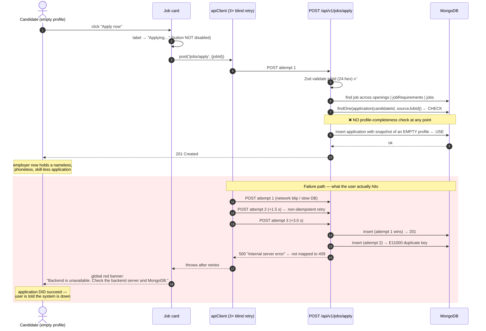
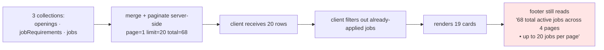
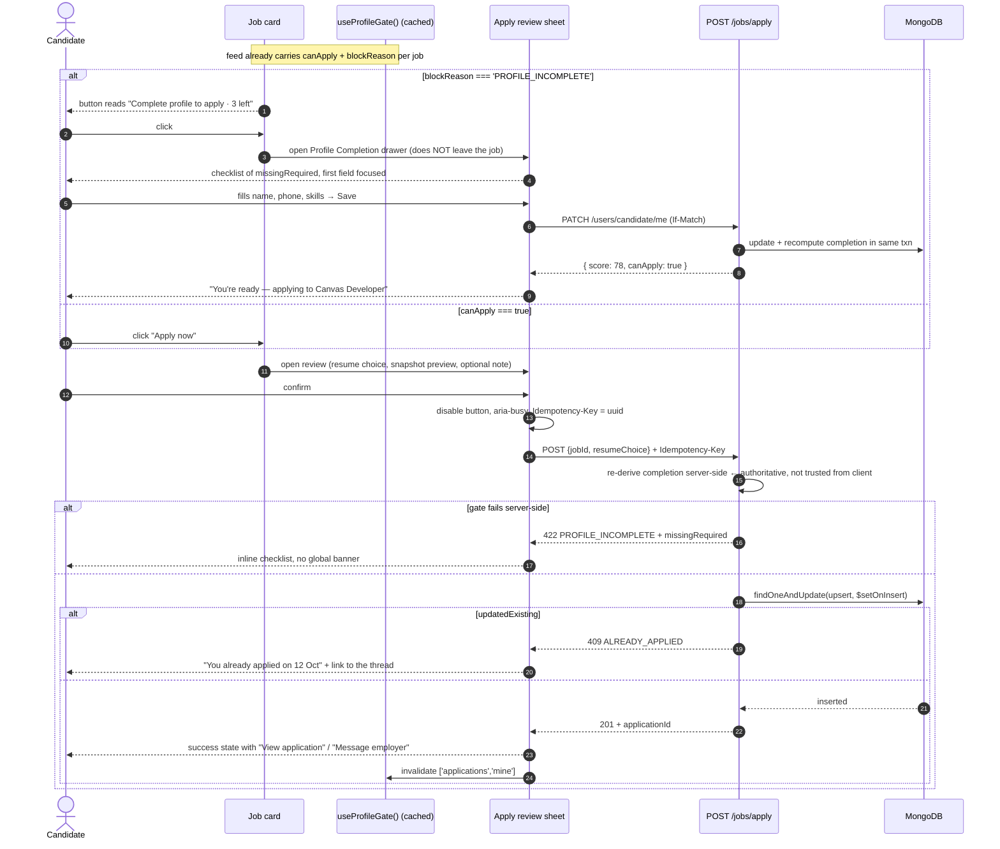
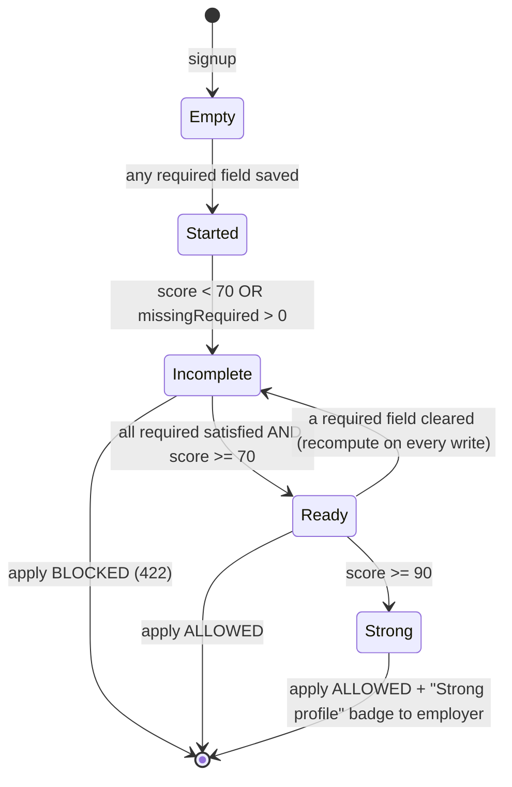
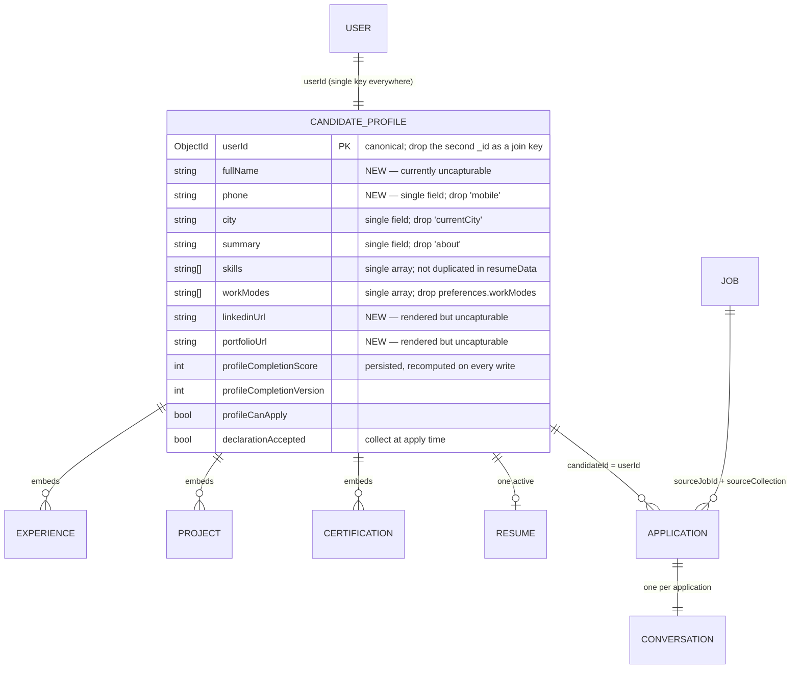

# RecruitKr — Candidate Dashboard & Apply Flow Audit

**Audited:** 30 Oct 2026
**Target:** `https://www.recruitkr.com/dashboard/candidate` (production, live account `pekkarockz1@gmail.com`, Candidate ID `RKR-2026-Q6FG`)
**Method:** live black-box audit — DOM/accessibility inspection, network capture, authenticated API probing, and a controlled concurrency test against the real apply endpoint.
**Audience:** Claude Code (this file is the full working context for the fix).

> Every finding below is tagged **[VERIFIED]** (reproduced live during this audit, evidence quoted) or **[INFERRED]** (deduced from observable behaviour; confirm against source before changing code).

---

## 0. TL;DR — the five things that matter

| # | Problem | Why it is severe |
|---|---|---|
| 1 | **There is no name or phone input anywhere in the candidate profile editor.** The saved profile has `name: ""`, `phone: ""`, and every application snapshot carries `fullName: ""`, `phone: ""`. | Employers receive **anonymous, uncontactable applications**. This alone makes the product unusable for the buyer side. Gating on profile completion is pointless until the fields exist. |
| 2 | **`profileCompletion` returns `72` for a 100% empty profile.** | Any gate built on today's score passes an empty profile at "72%". The scoring function must be rewritten **before** the gate, or the gate is theatre. |
| 3 | **Apply is a one-click, unguarded write.** `POST /api/v1/jobs/apply` with `{jobId}` succeeds on an empty profile. No confirm step, no review, no profile check, client-side or server-side. | This is the flaw you reported. Fix must be server-first; a client-only gate is bypassable with one `fetch()`. |
| 4 | **The API client blind-retries non-idempotent POST/PATCH 3× at 1.5 s intervals**, and the apply endpoint **TOCTOU-races into a 500** on concurrent submits. | One click = 3 writes. A double-tap on a slow network produces a successful application *plus* a red banner reading "Backend is unavailable. Check the backend server and MongoDB." |
| 5 | **Every tab switch refetches the entire dashboard, 3× each.** 224 API calls in 279 seconds from ~12 clicks. | Mobile data burn, MongoDB load, and the root cause of several stale-state races. |

---

## 1. System map

### 1.1 Stack **[VERIFIED]**

| Layer | Evidence |
|---|---|
| **Next.js (App Router)** | `/_next/static/chunks/app/dashboard/candidate/page-*.js`, `app/layout-*.js`, `app/not-found-*.js` |
| **Single-page tabbed dashboard** | All six tabs render under one route, `/dashboard/candidate`; URL never changes on tab switch |
| **REST API, versioned** | `/api/v1/*`, envelope `{ success, data, meta?, source? }` |
| **MongoDB** | 24-char hex `_id`, `__v`, `E11000`-shaped failure on concurrent insert |
| **Zod request validation** | 400 body: `{"code":"too_small","minimum":24,"inclusive":true,...}` |
| **JWT in `localStorage`** *(INFERRED — redacted by the audit tool, confirm in code)* | A `localStorage` key holding a JWT is present; no JS-visible cookies (`document.cookie` empty) |
| **Cloudflare** | `static.cloudflareinsights.com/beacon.min.js`, `/cdn-cgi/rum` |

### 1.2 Endpoints observed **[VERIFIED]**

```
GET    /api/v1/ping                                  → liveness, drives "Live connected" chip
GET    /api/v1/dashboards/candidate                  → { stats{applicationsSent,interviewCalls,offersReceived,profileCompletion}, applications[] }
GET    /api/v1/users/candidate/me                    → candidate profile document
PATCH  /api/v1/users/candidate/me                    → body: {experienceStatus, summary, skills, projects,
                                                              certifications, referral, resumeType, resumeData}
GET    /api/v1/users/candidate/certificates
GET    /api/v1/users/candidate/videos
GET    /api/v1/resumes/mine                          → { resumeType, resumeId, resumeUrl, resumeFileId, fileName }
GET    /api/v1/jobs?page=1&limit=20                  → { data[], meta{pagination{page,limit,total,totalPages}}, source }
GET    /api/v1/jobs/applications/mine                → application[]
POST   /api/v1/jobs/apply   { jobId }                → 201 | 400 | 404 | 409 | 500
GET    /api/v1/conversations
GET    /api/v1/conversations/:id/messages
```

### 1.3 Live data shapes **[VERIFIED]**

Candidate profile — **every meaningful field empty**, yet the dashboard reports 72% complete:

```jsonc
// GET /api/v1/users/candidate/me
{ "preferences": { "workModes": [] },
  "_id": "…2518",          // CandidateProfile document
  "userId": "…2515",       // User (auth) document  ← applications key off THIS id
  "summary": "", "skills": [], "referral": "", "profilePhotoUrl": "", "profilePhotoFileId": "",
  "about": "", "city": "", "currentCity": "", "email": "pekkarockz1@gmail.com",
  "isActive": true, "mobile": "", "name": "", "phone": "",
  "preferredIndustry": "", "preferredLocation": "", "preferredRole": "",
  "resumePath": "", "workModes": [],
  "declarationAccepted": false, "representationAuthorized": false,
  "projects": [], "certifications": [], "videos": [],
  "recruitkrId": "RKR-2026-Q6FG", "__v": 0 }
```

Job feed item — note `sourceCollection` and the server-side `canApply` flag:

```jsonc
// GET /api/v1/jobs → data[0]
{ "_id": "…08ab", "jobTitle": "store manager ", "jobLocation": "vaishali DCM ",
  "employmentType": "Not specified", "companyName": "gau seva sadan",
  "description": "", "department": "", "experienceRequired": "", "qualification": "",
  "preferredIndustryBackground": "", "workModes": [], "urgencyLevel": "",
  "requirements": [], "responsibilities": [], "skills": [],
  "genderRequirement": "", "applicationDeadline": "",
  "sourceCollection": "openings", "sourceLabel": "RecruitKr Hiring",
  "ownerRole": "admin", "canApply": true, "isLegacy": false }
```

Application record produced by an empty profile — **this is what the employer sees**:

```jsonc
{ "candidateId": "…2515", "clientId": "…14e1",
  "sourceCollection": "openings", "sourceJobId": "…08ab",
  "sourceJobSnapshot": { "jobTitle": "store manager", "jobLocation": "vaishali DCM",
                         "employmentType": "", "companyName": "gau seva sadan" },
  "fullName": "",            // ← empty
  "email": "pekkarockz1@gmail.com",
  "phone": "",               // ← empty
  "qualification": "", "college": "", "currentCity": "", "profilePhotoUrl": "",
  "skills": [],              // ← empty
  "experienceLabel": "Fresher",
  "preferredLocation": "", "portfolioUrl": "", "linkedinUrl": "",
  "experience": [ { "jobProfile": "Fresher" } ],   // ← fabricated default
  "resumePath": "generated", "hasCustomResume": false,
  "status": "applied", "timeline": [ { "status": "applied", … } ],
  "unreadCandidateCount": 0, "unreadEmployerCount": 1 }
```

### 1.4 Information architecture as built **[VERIFIED]**

```
/dashboard/candidate  (one route, six bottom-nav tabs, no URL state)
├── Overview     hero + Quick Snapshot + 4 stat tiles + Recent activity
├── Find Jobs    search + location filter + job-type filter + Reset + job cards + pagination
├── Applied Jobs application list → expandable detail
├── My Chat      conversation list + thread (per application)
├── Profile      READ-ONLY profile card  ← misnamed
└── My Card      THE EDITOR (videos, resume editor, photo, certificates, projects, certifications, referral)  ← misnamed
```

---

## 2. Current flows (as-built)

### 2.1 Apply — current



### 2.2 Profile save — current

```mermaid
sequenceDiagram
    autonumber
    actor C as Candidate
    participant UI as "My Card" editor
    participant API as apiClient
    participant SRV as PATCH /users/candidate/me

    C->>UI: edits fields (no <form>, no labels, nothing required)
    C->>UI: click "Save"
    UI->>API: patch(body: whole-document snapshot)
    API->>SRV: PATCH attempt 1
    API->>SRV: PATCH attempt 2 (+1.5 s)   ← same stale snapshot
    API->>SRV: PATCH attempt 3 (+3.0 s)   ← last-write-wins, no version/ETag
    SRV-->>UI: (no success toast rendered near the button)
    Note over UI: profileCompletion is NOT recomputed<br/>client-side — Overview keeps showing the stale score
```



### 2.3 Job feed — current



---

## 3. Findings

Severity: **P0** = ships broken / data integrity · **P1** = user-visible defect or security-relevant · **P2** = quality, performance, polish.

### P0 — Correctness & data integrity

---

#### P0-1 · No name or phone input exists in the candidate profile **[VERIFIED]**

The "My Card" editor contains exactly 15 form controls, enumerated from the DOM:

| # | Control | Placeholder |
|---|---|---|
| 1–2 | `input[type=file]` | video upload, resume PDF |
| 3 | `input[type=text]` | `e.g. B.Tech / MBA / Diploma` |
| 4 | `select` | Experience Status (Fresher / Experienced) |
| 5 | `textarea` | `Write a short professional summary (optional)` |
| 6 | `input[type=text]` | `e.g. JavaScript, Node.js, React, MongoDB` |
| 7 | `input[type=text]` | `e.g. Backend Developer` |
| 8 | `input[type=text]` | `e.g. Delhi / Bengaluru` |
| 9 | `input[type=text]` | `e.g. IT / FinTech` |
| 10–12 | `input[type=checkbox]` | On-site / Hybrid / Remote |
| 13–14 | `input[type=file]` | profile photo, certificates |
| 15 | `input[type=text]` | `Optional referral info` |

**There is no field for full name, phone number, city, college, LinkedIn or portfolio.** Yet the read-only "Profile" tab renders `LINKEDIN — Not added`, `PORTFOLIO — Not added`, and the Overview greets the user as *"Welcome, pekkarockz1@gmail.com"* because `name` can never be populated.

**Impact:** the application record sent to employers is anonymous and uncontactable. **Fix this before anything else** — the gate in §4 depends on these fields existing.

---

#### P0-2 · `profileCompletion` scores an empty profile at 72% **[VERIFIED]**

```jsonc
// GET /api/v1/dashboards/candidate
"stats": { "applicationsSent": 1, "interviewCalls": 0, "offersReceived": 0, "profileCompletion": 72 }
```

against a profile where `name`, `phone`, `summary`, `skills`, `preferredRole`, `preferredLocation`, `preferredIndustry`, `city`, `profilePhotoUrl`, `resumePath` are all empty strings and `projects`, `certifications`, `videos`, `workModes` are all `[]`.

**[INFERRED] cause:** the scorer counts *key presence* on the Mongo document (or counts always-populated system fields — `_id`, `userId`, `email`, `recruitkrId`, `isActive`, `createdAt`, `__v`, and boolean `false` flags) rather than *meaningful value presence*. `Boolean(user.declarationAccepted !== undefined)` is truthy; `""` passed through a `Object.keys(doc).length` style ratio is truthy.

**Self-contradiction visible in one viewport:** the Overview shows `72% Profile strength` directly beside `Preferred Role: Not set yet · Preferred Location: Not set yet · Work Mode: Not selected`.

---

#### P0-3 · Apply succeeds with an empty profile — no gate on either side **[VERIFIED]**

Reproduced live. `POST /api/v1/jobs/apply` with body `{"jobId":"<24-hex>"}` returned **201 Created** from an account whose profile is entirely empty. The UI shows no modal, no confirmation, no review step: the button's label flips to "Applying…" and the write is already in flight.

The server validates only the *shape* of `jobId`. There is no profile predicate anywhere in the path.

**Note the existing hook point:** `GET /api/v1/jobs` already returns a per-job `canApply: true` boolean. The gate has a natural home — see §4.3.

---

#### P0-4 · TOCTOU race: concurrent apply returns 500, not 409 **[VERIFIED — controlled test]**

Two concurrent `POST /api/v1/jobs/apply` with the same `jobId`, fired with `Promise.all`:

| Request | Status | Body |
|---|---|---|
| A | **201** | `{"success":true,"data":{…}}` |
| B | **500** | `{"success":false,"message":"Internal server error"}` |

Sequential re-apply, by contrast, is handled correctly:

| Probe | Status | Body |
|---|---|---|
| Sequential duplicate | **409** | `{"success":false,"message":"Already applied to this job"}` |
| `jobId: "notavalidobjectid"` | 400 | Zod `too_small`, `minimum: 24` |
| `jobId: "000000000000000000000000"` | 404 | `{"message":"Job not found"}` |
| `{}` (missing `jobId`) | 400 | Zod `invalid_type`, `path: ["jobId"]` |

**Diagnosis:** the handler does `findOne()` → *(gap)* → `insertOne()`. Under concurrency both reads miss, both writes fire, the unique index rejects the second, and the `E11000` escapes as an unhandled 500. The DB index is doing the work the application layer should do — and the error mapping is missing.

**Final state after the test:** exactly **1** application for that job (`recordsForThisJob: 1`), total applications 1 → 2.

> ⚠️ **Test data to clean up:** this probe created one real application for **"Sales/Peon (Fresher)"** on candidate `RKR-2026-Q6FG`. Delete it from `applications` (and its auto-created conversation) before demoing.

---

#### P0-5 · Non-idempotent writes are blind-retried 3× **[VERIFIED]**

A **single** click on "Apply now" produced three POSTs:

```
POST /api/v1/jobs/apply  {jobId}  t=…360205
POST /api/v1/jobs/apply  {jobId}  t=…361708   (+1503 ms)
POST /api/v1/jobs/apply  {jobId}  t=…363209   (+1501 ms)
console: "[api] request failed after retries"   (chunks/2117-*.js)
```

A **single** click on "Save" in the resume editor produced three PATCHes with an identical body:

```
PATCH /api/v1/users/candidate/me
  body keys: [experienceStatus, summary, skills, projects, certifications, referral, resumeType, resumeData]
  ×3, 1.5 s apart
```

The retry wrapper is applied to **all** methods, not just GET. Combined with P0-4 this is the duplicate-application machine: retry → race → 500 → retry → 500. It is also a last-write-wins clobber risk on PATCH (see P1-4).

---

#### P0-6 · Developer-facing error leaks to candidates, and contradicts the status chip **[VERIFIED]**

When the write failed, a persistent global banner rendered:

> **Backend is unavailable. Check the backend server and MongoDB.**

Problems, in order: (a) it names the database to an end user; (b) it is a *wrong diagnosis* — any failed write produces it; (c) it is global and survives tab switches instead of appearing next to the control that failed; (d) it never auto-dismisses and has no retry affordance; (e) the header simultaneously shows a green **"Live connected"** chip. The Apply button itself showed **nothing** — it silently reverted from "Applying…" to "Apply now", so a candidate cannot tell whether they applied.

---

### P1 — Duplication, state and security

---

#### P1-1 · The job feed merges three collections; duplicate roles surface to candidates **[VERIFIED]**

`GET /api/v1/jobs?page=1&limit=20` returns rows from **three** source collections in one list:

```json
"sourceCollections": ["openings", "jobRequirements", "jobs"]
```

Page 1 alone contains duplicate titles: **"Computer Operator" ×2** and **"Helper" ×2** (distinct `_id`s, so it is cross-collection or cross-employer duplication, not a bad `$lookup`). No canonical job identity, no dedupe key, no "posted by" distinction beyond a cosmetic `sourceLabel`.

#### P1-2 · Pagination count lies because filtering happens after pagination **[VERIFIED]**

The API returns `meta.pagination = { page:1, limit:20, total:68, totalPages:4 }` and **20** rows. The client then removes jobs the candidate has already applied to and renders **19** cards, while the footer still prints:

> "Page 1 is showing 19 jobs — 68 total active jobs across 4 pages • up to 20 jobs per page"

Confirmed by DOM count: **19** "Apply now" buttons. With 20 applications on one page the candidate would see an **empty page** with a "Next page" button. Filtering must move server-side into the query, with `total` reflecting the filtered set.

#### P1-3 · The profile data model stores the same facts in multiple places **[VERIFIED]**

From a single `GET /api/v1/users/candidate/me` response plus the `PATCH` body:

| Fact | Storage locations found |
|---|---|
| Work mode | `workModes[]` **and** `preferences.workModes[]` **and** (via PATCH) `resumeData` |
| Phone | `phone` **and** `mobile` |
| City | `city` **and** `currentCity` |
| Summary | `summary` **and** `about` |
| Skills | `skills[]` **and** `resumeData.skills` |
| Resume | `resumePath` on the user doc **and** `GET /api/v1/resumes/mine` (`resumeId`, `resumeUrl`, `resumeFileId`) |
| Name | `name` on profile **and** `fullName` on the application snapshot |

The Overview's Quick Snapshot reads one copy ("Not set yet") while the editor writes another (`resumeData`). This is the structural reason the dashboard and the editor disagree, and it will make any completion score non-deterministic.

#### P1-4 · Whole-document PATCH with no concurrency control **[VERIFIED]**

`PATCH /api/v1/users/candidate/me` sends a full snapshot of the editor's state with no `updatedAt` precondition, `If-Match`/ETag, or field-level diff. Two tabs, or the 3× retry, or a slow save racing an upload callback, all clobber each other silently. Combine with P1-3 (two copies of each field) and a save can *un-set* data the user just entered elsewhere.

#### P1-5 · Dual identity: `profile._id` ≠ `application.candidateId` **[VERIFIED]**

`candidateProfile._id = …2518`, `candidateProfile.userId = …2515`, and `application.candidateId = …2515`. Applications key off the **User** id while the profile document has its own `_id`. Any gate, completion score, or employer-side join must consistently resolve `userId → profile`; a single wrong key here silently returns an empty profile and would make the gate either always-pass or always-fail.

#### P1-6 · Auth token in `localStorage` **[INFERRED — confirm in code]**

`document.cookie` is empty from JS and a JWT-shaped value lives in `localStorage`. If so, the session is readable by any XSS on the origin and cannot be `httpOnly`/`SameSite`-protected. Recommend httpOnly + `SameSite=Lax` cookies with CSRF protection on writes.

---

### P2 — UX, design and performance

#### P2-1 · "Profile" and "My Card" are inverted **[VERIFIED]**
The **Profile** tab is a read-only card ("Not added", "Upload a profile photo from the Resume tab"). The **My Card** tab is the actual editor. Users looking to fill their profile land on a dead end that tells them to go somewhere else. Both tabs are also reachable from a six-item bottom bar that persists on desktop, where a sidebar or top nav belongs.

#### P2-2 · Job cards render placeholder noise as if it were data **[VERIFIED]**
Of 19 cards on page 1, **18** show `0–0 LPA`, `Company not shared`, `Location not shared • Not specified`, and chips reading `Department pending`, `Experience pending`, `Qualification pending`, with body text "No detailed description shared for this opening." The location filter is polluted by the same dirty data — its options include `Location not shared` and `vaishali DCM ` (trailing space, unnormalised).

#### P2-3 · Forms are inaccessible **[VERIFIED]**
In the editor: **0** `<form>` elements, **15** inputs, **0** with `id`, `name`, or `aria-label`, **12** `<label>` elements **none** of which use `for=`, **0** fields marked `required`. Consequences: screen readers announce unlabeled controls, browser autofill cannot work, there is no Enter-to-submit, and no native validation. Heading levels skip a rank: the Find Jobs tab has one `h1` ("Candidate Dashboard"), **zero** `h2`, and jumps straight to 18 `h3` job titles; job cards are `<div>`s rather than `<article>`s.

#### P2-4 · No URL state **[VERIFIED]**
All six tabs live at `/dashboard/candidate`. Tabs cannot be linked, bookmarked, or restored; browser Back exits the dashboard; a failed apply cannot be deep-linked back to the job.

#### P2-5 · Refetch storm — 224 API calls in 279 s **[VERIFIED]**

```
dashboards/candidate        44
jobs                        44
jobs/applications/mine      44
resumes/mine                43
users/candidate/me          43
──────────────────────────────
total                      224   (page age 279 s, ~12 user interactions, 0 background polling)
```

Each trigger fires every endpoint **3×** (effect double-invoke + an un-guarded dependency, **[INFERRED]**), and every tab switch refetches everything — including the paginated job list, which **discards the candidate's filters and page position**. No cache, no `AbortController`, no in-flight dedupe. Late responses from a cancelled fetch can overwrite newer state (classic response-ordering race).

#### P2-6 · Apply has no review step **[VERIFIED]**
One click = submitted. The candidate never sees what is being sent, cannot choose between their generated and uploaded resume, cannot add a note, and gets no "applied" receipt beyond the card disappearing from the list.

#### P2-7 · Misc **[VERIFIED]**
Hero greets with the email address, not a name (consequence of P0-1). Job titles and locations are stored with trailing whitespace (`"store manager "`, `"vaishali DCM "`). `experience: [{ jobProfile: "Fresher" }]` is fabricated by the server for candidates who entered nothing. `declarationAccepted` and `representationAuthorized` exist on the model but are `false` and never collected — applications are submitted without the consent the schema anticipates.

---

## 4. The fix — specification

### 4.1 Profile completion engine (rewrite, server-owned)

One pure function, one source of truth, shared by API and UI. Never computed in a component.

```ts
// packages/shared/profile-completion.ts   (or src/lib/profile/completion.ts)
export const PROFILE_COMPLETION_VERSION = 2;

const nonEmpty = (v?: string | null, min = 1) =>
  typeof v === 'string' && v.trim().length >= min;

export type CompletionField = {
  key: string; label: string; weight: number;
  required: boolean;            // hard blocker for applying
  group: 'identity' | 'professional' | 'preferences' | 'proof';
  satisfied: boolean;
};

export function computeProfileCompletion(p: CandidateProfile) {
  const f: CompletionField[] = [
    // ── identity (22) ───────────────────────────────────────────────
    { key:'fullName',     label:'Full name',          weight: 7, required:true,  group:'identity',
      satisfied: nonEmpty(p.fullName, 3) && p.fullName.trim().split(/\s+/).length >= 2 },
    { key:'phone',        label:'Phone number',       weight: 7, required:true,  group:'identity',
      satisfied: /^[6-9]\d{9}$/.test((p.phone ?? '').replace(/\D/g,'').slice(-10)) },
    { key:'emailVerified',label:'Verified email',     weight: 3, required:true,  group:'identity',
      satisfied: p.emailVerified === true },
    { key:'photo',        label:'Profile photo',      weight: 5, required:false, group:'identity',
      satisfied: nonEmpty(p.profilePhotoUrl) },

    // ── professional (23) ───────────────────────────────────────────
    { key:'qualification',label:'Highest qualification', weight: 6, required:true, group:'professional',
      satisfied: nonEmpty(p.highestQualification, 2) },
    { key:'experienceStatus', label:'Fresher or experienced', weight: 3, required:true, group:'professional',
      satisfied: p.experienceStatus === 'fresher' || p.experienceStatus === 'experienced' },
    { key:'experienceDetail', label:'Work history',   weight: 6, required:true,  group:'professional',
      satisfied: p.experienceStatus === 'fresher'
        ? true
        : (p.experience ?? []).some(e => nonEmpty(e.company,2) && nonEmpty(e.role,2) && !!e.startDate) },
    { key:'summary',      label:'Professional summary', weight: 8, required:false, group:'professional',
      satisfied: nonEmpty(p.summary, 120) && new Set(p.summary.trim().toLowerCase().split(/\s+/)).size >= 15 },

    // ── preferences (24) ────────────────────────────────────────────
    { key:'skills',       label:'At least 3 skills',  weight: 8, required:true,  group:'preferences',
      satisfied: dedupeSkills(p.skills).length >= 3 },           // 3–4 → 5 pts, 5+ → 8 (see scoring note)
    { key:'preferredRole',label:'Preferred role',     weight: 5, required:true,  group:'preferences',
      satisfied: nonEmpty(p.preferredRole, 2) },
    { key:'preferredLocation', label:'Preferred location', weight: 4, required:true, group:'preferences',
      satisfied: nonEmpty(p.preferredLocation, 2) },
    { key:'preferredIndustry', label:'Preferred industry', weight: 4, required:false, group:'preferences',
      satisfied: nonEmpty(p.preferredIndustry, 2) },
    { key:'workModes',    label:'Work mode',          weight: 3, required:true,  group:'preferences',
      satisfied: (p.workModes ?? []).length > 0 },

    // ── proof (31) ──────────────────────────────────────────────────
    { key:'resume',       label:'Resume',             weight:11, required:true,  group:'proof',
      satisfied: p.resumeType === 'uploaded'
        ? nonEmpty(p.resumeFileId)
        : generatedResumeIsSubstantive(p) },                     // see note below
    { key:'certifications', label:'Certification or certificate', weight: 7, required:false, group:'proof',
      satisfied: (p.certifications ?? []).length > 0 || (p.certificateFiles ?? []).length > 0 },
    { key:'projects',     label:'Project',            weight: 8, required:false, group:'proof',
      satisfied: (p.projects ?? []).some(pr => nonEmpty(pr.title,3) && nonEmpty(pr.description,40)) },
    { key:'introVideo',   label:'Intro video',        weight: 5, required:false, group:'proof',
      satisfied: (p.videos ?? []).length > 0 },
  ];

  const score   = f.reduce((s, x) => s + (x.satisfied ? x.weight : 0), 0); // max 100
  const missing = f.filter(x => !x.satisfied);
  return {
    version: PROFILE_COMPLETION_VERSION,
    score,
    fields: f,
    missingRequired: missing.filter(x => x.required).map(x => ({ key:x.key, label:x.label })),
    missingOptional: missing.filter(x => !x.required).map(x => ({ key:x.key, label:x.label })),
    canApply: missing.every(x => !x.required) && score >= APPLY_GATE_MIN_SCORE,
  };
}
```

**Weights sum to exactly 100.** `required: true` fields total **63** (identity 17 + professional 15 + preferences 20 + resume 11), so the hard-required set alone lands at 63 and **cannot reach the 70 threshold**. A candidate must earn at least **7 more points** from the optional set — photo (5), summary (8), industry (4), certifications (7), projects (8), intro video (5). That gap is deliberate: filling the mandatory form gets you to 63; demonstrating something about yourself gets you to 70. That is the line between "registered" and "serious".

Graded sub-scores (implement as a small helper rather than a boolean) for the two fields where partial credit is meaningful:

| Field | 0 pts | partial | full |
|---|---|---|---|
| `skills` (8) | < 3 skills | 3–4 → 5 | 5+ → 8 |
| `summary` (8) | < 120 chars | 120–239 → 4 | 240+ → 8 |

**Anti-gaming rules (enforce server-side, in the same module):**

- `dedupeSkills` — trim, lowercase-compare, strip punctuation, reject duplicates and single-character entries; reject a skills string that is one word repeated.
- Reject a `summary` whose unique-word count is under 15, or that is the preferred role repeated.
- `fullName` must be ≥ 2 words, ≥ 3 chars, and not an email address.
- `phone` must be a valid Indian mobile and **unique across candidates** (soft-flag, don't hard-block, to avoid locking out shared family numbers — log for admin review).
- `generatedResumeIsSubstantive(p)` — the generated resume counts only when qualification, skills ≥ 3, preferred role, and (summary ≥ 120 chars **or** ≥ 1 experience entry **or** ≥ 1 project) are all present. Otherwise "generated" is an empty PDF and must not satisfy a 12-point field.

**Persistence:** store `profileCompletionScore`, `profileCompletionVersion`, `profileCanApply`, `profileCompletionComputedAt` on the candidate document; recompute inside the same transaction as **every** profile write (PATCH, photo upload, resume upload, certificate upload, project/certification add/remove). Never recompute on read — on read, if `profileCompletionVersion !== PROFILE_COMPLETION_VERSION`, recompute and persist lazily.

### 4.2 The gate rule (your chosen policy)

> **A candidate may apply when: every `required` field is satisfied AND `score >= 70`.**

```ts
export const APPLY_GATE_MIN_SCORE = 70;
```

Put the constant in one shared module, read it from both the server guard and the UI copy, and expose it in the API response so the UI never hardcodes "70".

**Grandfathering:** existing candidates with applications already submitted should not be locked out mid-session without explanation. On first load after deploy, show a one-time dismissible banner: *"We now ask for a complete profile before applying — you're at X%, N items left."* Do **not** retroactively invalidate past applications.

### 4.3 API contract changes

```
GET  /api/v1/users/candidate/profile-completion
  200 → { success, data: { version, score, threshold: 70, canApply,
                           fields: [...], missingRequired: [...], missingOptional: [...] } }

GET  /api/v1/jobs?page&limit
  → each row gains:
      canApply: boolean            // false when the gate blocks, OR already applied, OR job closed
      blockReason: 'PROFILE_INCOMPLETE' | 'ALREADY_APPLIED' | 'JOB_CLOSED' | null
  → meta.pagination.total MUST reflect the server-side filtered count (fixes P1-2)
  → add ?excludeApplied=true and do the exclusion in the query, not the client

POST /api/v1/jobs/apply
  headers: Idempotency-Key: <uuid v4, generated once per job card mount>
  body:    { jobId, resumeChoice?: 'generated'|'uploaded', note?: string }
  201 → created
  409 → { code:'ALREADY_APPLIED',   message:'You have already applied to this job' }
  422 → { code:'PROFILE_INCOMPLETE',
          message:'Complete your profile to apply',
          data: { score: 48, threshold: 70,
                  missingRequired: [{key:'phone',label:'Phone number'}, …] } }
  423 → { code:'JOB_CLOSED' }
  // 500 must never be reachable for a duplicate — map E11000 → 409
```

### 4.4 Concurrency and idempotency

1. **Unique index** (it already exists in effect — make it explicit and named):
   `db.applications.createIndex({ candidateId: 1, sourceJobId: 1 }, { unique: true, name: 'uniq_candidate_job' })`
2. **Replace check-then-insert with an atomic upsert**, so the race cannot occur:
   `findOneAndUpdate({candidateId, sourceJobId}, {$setOnInsert: {...}}, {upsert:true, returnDocument:'after', includeResultMetadata:true})` → if `lastErrorObject.updatedExisting` is true, return **409**, not 201.
3. **Catch `E11000`** at the route boundary and map it to 409 with the `ALREADY_APPLIED` code. No Mongo error shape should ever reach a response body.
4. **Idempotency keys** — store `idempotencyKey` (unique, TTL 24 h) on the application; a repeat with the same key returns the original 201 response rather than a 409.
5. **Client:** retry **GET only**. Never retry POST/PATCH/PUT/DELETE. Explicit allowlist in the api client:
   `const RETRYABLE = new Set(['GET','HEAD','OPTIONS']);`
6. **Button state:** disable on click, keyed by `jobId` in a `Set<string>` of in-flight ids, re-enabled in `finally`. Add `aria-busy`.
7. **Profile PATCH:** send `If-Match: <updatedAt>` (or `expectedVersion`); server returns **412 Precondition Failed** on mismatch and the UI offers "reload and reapply your changes".

### 4.5 Fetch layer

Adopt **TanStack Query** (or SWR) and delete every hand-rolled `useEffect` fetch in the dashboard.

- `staleTime: 60_000` for `jobs`, `30_000` for `dashboards/candidate`, `profile`.
- One query key per resource: `['jobs', {page, filters}]`, `['applications','mine']`, `['profile','me']`, `['profile','completion']`.
- Tab switches read from cache — **zero** network calls.
- `invalidateQueries(['applications','mine'])` + `['profile','completion']` after a successful apply; `invalidateQueries(['profile'])` after a save.
- Optimistic apply with rollback on error.
- Target: **≤ 5 API calls** on cold load, **0** on tab switch, down from 224 / 279 s.

---

## 5. Proposed flows

### 5.1 Apply — proposed



### 5.2 Profile completion state



### 5.3 Target data model



---

## 6. UI / UX redesign

### 6.1 Information architecture

| Now | Change to | Why |
|---|---|---|
| `Profile` (read-only card) | **`Preview`** — "how employers see you", with a "Share profile" link | Names what it is |
| `My Card` (the editor) | **`Profile`** — the editor, URL `?tab=profile` | Users look for editing under "Profile" |
| 6-item bottom bar on desktop | Sidebar ≥ 1024 px, bottom bar < 768 px, 5 items max | Bottom bars are a phone pattern |
| No URL state | `?tab=jobs&page=2&q=sales&loc=jaipur` | Linkable, bookmarkable, Back works |

### 6.2 The completion widget (the centrepiece)

Replace the flat "72%" number with a **segmented progress ring + live checklist**, placed on Overview *and* pinned to the top of the editor:

- Ring segmented by the four groups (identity / professional / preferences / proof), each arc filling independently; **amber below 70, green at or above**.
- A `70%` tick mark drawn on the ring so the goal is visible, not just the number.
- Beneath it, the checklist from `missingRequired` + `missingOptional`, each row a button that scrolls to and focuses the field: **"Add your phone number · +7%"** — always show the point value, because showing the reward is what drives completion.
- Live recompute as the user types (same shared function, client-side for display only, server-side for the decision) — the ring animating from 62 → 70 as they add skills is the moment that converts.
- At 70 %: a one-time celebratory state — *"You can now apply to any job"* with a direct link back to the job they were blocked on.

### 6.3 Gated apply button states

| State | Label | Style | Action |
|---|---|---|---|
| `canApply` | **Apply now** | primary | opens review sheet |
| `PROFILE_INCOMPLETE` | **Complete profile to apply** + badge `3 left` | outline, lock icon, **not** disabled | opens completion drawer *over the job*, returns to apply on success |
| in flight | **Applying…** | primary, `disabled`, `aria-busy="true"`, spinner | — |
| `ALREADY_APPLIED` | **Applied ✓ · View** | ghost, green | opens the application thread |
| `JOB_CLOSED` | **Closed** | muted, disabled | — |

Never use a plain `disabled` attribute for the gate: a disabled button is unexplainable and unfocusable. The gate button must be clickable and must *teach*.

### 6.4 Apply review sheet

Bottom sheet on mobile, centred dialog on desktop. Shows: job title + employer; **exactly what will be sent** (name, phone, skills chips, resume filename) — this is the honesty step that the current one-click flow skips; resume selector (Generated / Uploaded) with a "Preview PDF" link; optional 300-char note; the declaration checkbox that populates `declarationAccepted`; a single primary **Submit application** button. Focus trap, `Esc` to close, focus returns to the originating card.

### 6.5 Job card cleanup

Hide rather than render placeholders: no `0–0 LPA` (show "Salary not disclosed" once, as muted meta, or nothing), no `Company not shared` (fall back to `sourceLabel`), no `Department pending` chips. Normalise `jobTitle`/`jobLocation` with `.trim()` at write time *and* backfill existing rows. Build filter options from a normalised, deduped set and drop `Location not shared` from the dropdown. Add a `Best match` sort using the candidate's `preferredRole` / `preferredLocation` / `skills` — the data is already there and it is the cheapest relevance win available.

### 6.6 Errors and feedback

Delete the global "Backend is unavailable…" banner. Replace with:

- **Contextual inline errors** next to the control that failed, with a **Retry** button for GETs.
- **Toasts** for success — "Applied to Canvas Developer" with an **Undo** affordance for 5 s if you add withdraw.
- **Skeletons**, not spinners, for list loading.
- The connection chip reflects real state: green `Live`, amber `Reconnecting…`, red `Offline — changes will be saved when you reconnect`. It must never read "Live connected" while an error banner is up.
- Never surface infrastructure names to candidates. One generic message + a correlation id, with the detail in logs.

### 6.7 Accessibility (blocking for release)

Wrap the editor in `<form onSubmit>`; give every control an `id` and a `<label for>`; mark required fields `required` + `aria-required`; `aria-describedby` for hint text; `aria-live="polite"` region announcing the completion score when it changes; `aria-invalid` + error text per field; visible focus rings; job cards as `<article>` with `<h3>` titles; verify contrast in both light and dark themes.

---

## 7. Implementation plan

Phases are ordered by dependency. **Phase 1 must land before Phase 3** — gating on fields that do not exist is a dead end.

### Phase 0 — Safety net *(0.5 d)*
- [ ] Snapshot the `applications`, `candidateprofiles`, `users` collections.
- [ ] **Delete the audit test application** for "Sales/Peon (Fresher)" on `RKR-2026-Q6FG`, and its conversation.
- [ ] Add a feature flag `FEATURE_APPLY_GATE` (default `false`) so the gate can be enabled per-environment.
- [ ] Add structured request logging with a correlation id on every `/api/v1` route.

### Phase 1 — Capture the missing fields *(1–1.5 d)* — **P0-1**
- [ ] Add to the profile editor: **Full name**, **Phone** (with country prefix, `inputmode="tel"`), **City**, **College/Institute**, **LinkedIn URL**, **Portfolio URL**, and a repeatable **Work experience** block (company, role, start, end, current) shown only when `experienceStatus === 'experienced'`.
- [ ] Wrap in a real `<form>`; add `id`/`<label for>`/`required`/`aria-*` to all 20+ controls.
- [ ] Extend the `PATCH /users/candidate/me` Zod schema and the Mongoose schema.
- [ ] Backfill `fullName` from the auth user's display name where available.
- [ ] **Acceptance:** a new candidate can enter name + phone, and `GET /users/candidate/me` returns them non-empty.

### Phase 2 — Collapse the duplicated model *(1–2 d)* — **P1-3, P1-5**
- [ ] Choose canonical fields: `phone` (drop `mobile`), `city` (drop `currentCity`), `summary` (drop `about`), `workModes` (drop `preferences.workModes`), `skills` (drop `resumeData.skills`).
- [ ] Write a one-shot migration script: coalesce each pair, longest/most-recent non-empty wins, log every conflict.
- [ ] Make `resumeData` a **projection** of the profile, not a second store — generate it at PDF time.
- [ ] Standardise on `userId` as the only candidate join key; audit every query that uses `candidateProfile._id`.
- [ ] **Acceptance:** `GET /users/candidate/me` returns no duplicate-meaning keys; the Quick Snapshot and the editor always agree.

### Phase 3 — Completion engine *(1 d)* — **P0-2**
- [ ] Implement `computeProfileCompletion` per §4.1 in a shared module importable by API and UI.
- [ ] Unit tests: empty profile → **0**; required-only → **63**; threshold cases at 69/70/71; every anti-gaming rule.
- [ ] Persist `profileCompletionScore/Version/CanApply` on every write path (PATCH, photo, resume, certificate, project, certification).
- [ ] Lazy recompute on read when `version` is stale.
- [ ] New endpoint `GET /users/candidate/profile-completion`.
- [ ] **Acceptance:** the current empty test profile reports **0%**, not 72%.

### Phase 4 — Server-side gate *(0.5–1 d)* — **P0-3**
- [ ] Guard in `POST /jobs/apply`: re-derive completion from the DB (never trust a client-sent score) → **422 `PROFILE_INCOMPLETE`** with `missingRequired` + `score` + `threshold`.
- [ ] `GET /jobs` sets `canApply` / `blockReason` per row; move the already-applied exclusion into the query and fix `meta.pagination.total` (**P1-2**).
- [ ] **Acceptance:** `curl -X POST /api/v1/jobs/apply` with a valid token and an incomplete profile returns 422 — the gate holds without a browser.

### Phase 5 — Concurrency & idempotency *(0.5–1 d)* — **P0-4, P0-5**
- [ ] Named unique index `uniq_candidate_job`.
- [ ] Replace check-then-insert with `findOneAndUpdate(..., {upsert:true, $setOnInsert})`; `updatedExisting` → 409.
- [ ] Map `E11000` → 409 at the route boundary; assert no Mongo error text can reach a response.
- [ ] `Idempotency-Key` header, stored with 24 h TTL, replaying the original response.
- [ ] **Client:** restrict retries to `GET|HEAD|OPTIONS`; add `AbortController`; disable the button per in-flight `jobId`.
- [ ] **Acceptance:** 10 concurrent applies to the same job → **1× 201, 9× 409, 0× 500**, exactly 1 DB row.

### Phase 6 — Fetch layer *(1 d)* — **P2-5**
- [ ] Introduce TanStack Query; delete the ad-hoc effects; fix the triple-fetch.
- [ ] Per-resource keys, `staleTime`, targeted invalidation after mutations.
- [ ] **Acceptance:** cold load ≤ 5 API calls; tab switch = **0**; filters and page survive a tab switch.

### Phase 7 — UI / UX *(2–3 d)* — **P2-1…P2-7**
- [ ] Rename and swap `Profile` ⇄ `My Card`; sidebar at desktop widths; `?tab=` URL state.
- [ ] Build the segmented completion ring + checklist (§6.2) and the completion drawer.
- [ ] Gated button states (§6.3) and the apply review sheet (§6.4), including `declarationAccepted`.
- [ ] Job card cleanup, title/location trim + backfill, filter normalisation, "Best match" sort.
- [ ] Replace the global error banner with contextual errors, toasts, skeletons; honest connection chip.
- [ ] **Acceptance:** axe-core reports 0 critical issues on the dashboard; full keyboard walkthrough of apply succeeds.

### Phase 8 — Hardening *(0.5 d)*
- [ ] Rate-limit `POST /jobs/apply` (e.g. 20/hour/candidate) and the profile PATCH.
- [ ] `If-Match`/`expectedVersion` on profile PATCH → 412 (**P1-4**).
- [ ] Move the session JWT to an httpOnly `SameSite=Lax` cookie + CSRF token on writes (**P1-6**).
- [ ] Rollout: enable `FEATURE_APPLY_GATE` in staging → 10% of candidates → all; watch apply-conversion.

### Test matrix

| Case | Expected |
|---|---|
| Empty profile → completion | `0`, `canApply: false`, 11 missing required |
| Required-only profile | `63`, `canApply: false` (below 70) |
| Required + summary (240+ chars) | `71`, `canApply: true` |
| Required + photo only | `68`, `canApply: false` (gap is the point) |
| Apply at 69% | 422 `PROFILE_INCOMPLETE` |
| Apply at 70% | 201 |
| Apply twice sequentially | 201, then 409 |
| Apply 10× concurrently | 1×201, 9×409, 0×500, 1 DB row |
| Same `Idempotency-Key` twice | 201 then the replayed 201 |
| `jobId` malformed / unknown / missing | 400 / 404 / 400 |
| Direct `curl` POST bypassing UI, incomplete profile | 422 |
| Two tabs save the profile concurrently | second → 412, no silent clobber |
| Tab switch after load | 0 network calls; filters preserved |
| Skills `["js","js","JS "]` | counted as 1 → required unsatisfied |
| Summary = preferred role ×20 | summary unsatisfied |
| Screen reader through the editor | every control announced with its label |

---

## 8. Ready-to-paste Claude Code prompt

> Paste from the line below. Keep this audit file in the repo (e.g. `docs/audits/candidate-flow-2026-10-30.md`) and point the prompt at it.

```
You are working on RecruitKr — a Next.js (App Router) + MongoDB job platform.
Read docs/audits/candidate-flow-2026-10-30.md in full before writing any code. It is a live
black-box audit of the candidate dashboard with reproduced evidence, API contracts, sequence
diagrams, a completion-scoring spec and a phased plan. Treat it as the requirements document.

GOAL
Candidates can currently apply to any job with a completely empty profile, in one unguarded
click. Close that hole and fix the defects that make it unfixable today.

POLICY DECISION (already made — implement exactly this)
A candidate may apply only when BOTH hold:
  (a) every field marked required:true in computeProfileCompletion is satisfied, and
  (b) the weighted completion score is >= 70.
Enforce this on the SERVER first. The client gate is UX only and must never be the sole check.

NON-NEGOTIABLE ORDER OF WORK
Phase 1 before Phase 3 before Phase 4. The profile editor currently has NO input for full name
or phone number, so gating on them before adding them would lock every candidate out.

1. ORIENT
   - Map the repo: locate the candidate dashboard page, the api client with the retry wrapper
     (it logs "[api] request failed after retries"), the /api/v1/jobs/apply route, the
     /api/v1/users/candidate/me PATCH route, the dashboards/candidate route, and the Mongoose
     schemas for the candidate profile and applications.
   - Report what you found and where it differs from the audit's inferences BEFORE changing code.
     The audit marks each finding [VERIFIED] or [INFERRED]; verify the inferred ones in source.

2. PHASE 1 — add the missing profile fields (audit §7 Phase 1, finding P0-1)
   Full name, phone, city, college, LinkedIn, portfolio, and a repeatable work-experience block.
   Wrap the editor in a real <form>; every control gets id + <label for> + required + aria-*.
   Extend the Zod and Mongoose schemas. Do not touch the apply route yet.

3. PHASE 2 — collapse duplicated model fields (audit §7 Phase 2, findings P1-3, P1-5)
   phone/mobile, city/currentCity, summary/about, workModes/preferences.workModes,
   skills/resumeData.skills are each stored twice. Pick the canonical one, write a migration
   that coalesces and logs conflicts, make resumeData a derived projection, and standardise on
   userId as the only candidate join key.

4. PHASE 3 — rewrite the completion engine (audit §4.1, finding P0-2)
   Today GET /api/v1/dashboards/candidate returns profileCompletion: 72 for a profile where every
   field is an empty string or empty array. Implement computeProfileCompletion exactly as
   specified in §4.1 — weights summing to 100, required fields summing to 63, graded sub-scores
   for skills and summary, and every anti-gaming rule. Put it in ONE shared module imported by
   both the API and the UI. Persist score/version/canApply on every write path. Add
   GET /api/v1/users/candidate/profile-completion.
   Unit tests first: empty -> 0, required-only -> 63, boundary at 69/70/71.

5. PHASE 4 — server gate (audit §4.3, finding P0-3)
   POST /api/v1/jobs/apply re-derives completion from the DB and returns 422 PROFILE_INCOMPLETE
   with { score, threshold, missingRequired[] } when it fails. Never trust a client-sent score.
   GET /api/v1/jobs returns canApply + blockReason per row, moves the already-applied exclusion
   into the query, and fixes meta.pagination.total (today it returns 20 rows and total 68 while
   the client renders 19 cards and the footer contradicts itself).

6. PHASE 5 — concurrency (audit §4.4, findings P0-4, P0-5)
   Reproduced live: two concurrent applies to the same jobId return 201 and 500; sequential
   returns a correct 409. Replace check-then-insert with findOneAndUpdate upsert + $setOnInsert,
   add the named unique index uniq_candidate_job, map E11000 to 409, and support an
   Idempotency-Key header with a 24h TTL.
   On the client: the api client blind-retries non-idempotent writes 3x at 1.5s (one click on
   Apply produced three POSTs; one click on Save produced three PATCHes). Restrict retries to
   GET/HEAD/OPTIONS, add AbortController, and disable the apply button per in-flight jobId.

7. PHASE 6 — fetch layer (finding P2-5)
   224 API calls in 279 seconds from ~12 clicks; every tab switch refetches everything 3x and
   discards the job filters. Move to TanStack Query with per-resource keys, staleTime, and
   targeted invalidation. Target: <=5 calls cold, 0 on tab switch.

8. PHASE 7 — UX (audit §6)
   Swap the inverted tab names (today "Profile" is read-only and "My Card" is the editor), add
   ?tab= URL state, build the segmented completion ring with the point-valued checklist, the
   gated button states, and the apply review sheet that shows the candidate exactly what is being
   sent and collects declarationAccepted. Replace the global banner reading
   "Backend is unavailable. Check the backend server and MongoDB." with contextual errors.

CONSTRAINTS
- The server gate is authoritative. I will test it with curl, bypassing the UI entirely.
- No Mongo error text, collection name or infrastructure detail may ever reach a response body
  or the UI.
- Never retry a non-idempotent HTTP method.
- Never gate behind a plain disabled attribute — the gated button must be clickable and explain
  what is missing.
- Feature-flag the gate (FEATURE_APPLY_GATE) and ship a one-time explanatory banner for existing
  candidates rather than silently locking them out.

DELIVERABLES PER PHASE
A summary of what changed, the files touched, the tests added, and how to verify by hand.
Stop after each phase and wait for my review before starting the next.

START WITH STEP 1 ONLY. Do not write feature code until you have reported the repo map and
confirmed or corrected the audit's [INFERRED] items.
```

---

## 9. Evidence appendix

| Claim | Evidence captured |
|---|---|
| Empty profile | `GET /users/candidate/me` — all strings `""`, all arrays `[]` |
| 72% completion | `GET /dashboards/candidate` → `stats.profileCompletion: 72` |
| Apply with empty profile succeeds | `POST /jobs/apply` → **201**, record created with `fullName:""`, `phone:""`, `skills:[]` |
| Triple write on one click | 3× `POST /jobs/apply` at +0 / +1503 / +3004 ms; 3× `PATCH /users/candidate/me` identical body |
| Retry wrapper | console: `[api] request failed after retries` from `chunks/2117-*.js` |
| Concurrency race | `Promise.all([apply, apply])` → `[{status:201},{status:500,"Internal server error"}]`, 1 row persisted |
| Correct sequential handling | re-apply → **409** `"Already applied to this job"` |
| Validation | malformed id → 400 Zod `too_small/minimum:24`; unknown id → 404 `"Job not found"`; missing → 400 `invalid_type` |
| 3 job collections | `sourceCollections: ["openings","jobRequirements","jobs"]` |
| Duplicate roles | "Computer Operator" ×2, "Helper" ×2 on page 1, distinct `_id`s |
| Pagination mismatch | API 20 rows / `total:68`; DOM 19 "Apply now" buttons; footer "showing 19 jobs … up to 20 jobs per page" |
| Refetch storm | `dashboards/candidate` 44, `jobs` 44, `applications/mine` 44, `resumes/mine` 43, `users/candidate/me` 43 — 224 total in 279 s, 0 background polling |
| Missing name/phone inputs | DOM enumeration of all 15 editor controls (§P0-1 table) |
| Accessibility | 0 `<form>`, 15 inputs, 0 with `id`/`name`/`aria-label`, 12 `<label>` with no `for`, 0 `required` |
| Dev error leak | banner "Backend is unavailable. Check the backend server and MongoDB." rendered beside a green "Live connected" chip |
| Field duplication | `phone`+`mobile`, `city`+`currentCity`, `summary`+`about`, `workModes`+`preferences.workModes`, `skills`+`resumeData.skills` in one response |
| Identity split | `profile._id` ≠ `profile.userId` = `application.candidateId` |

### Cleanup required

1. Delete the test application for **"Sales/Peon (Fresher)"** on candidate `RKR-2026-Q6FG` and its auto-created conversation.
2. The pre-existing **"store manager"** application was not created by this audit — leave it if it is intentional test data.
